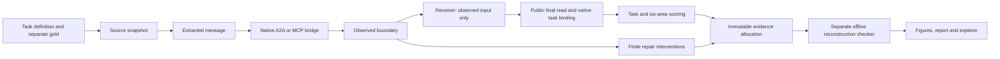
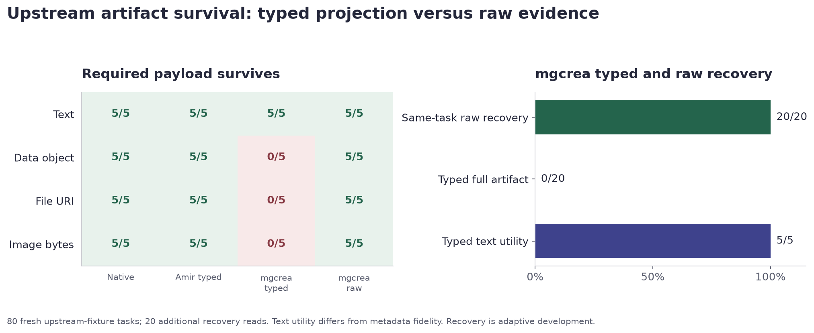
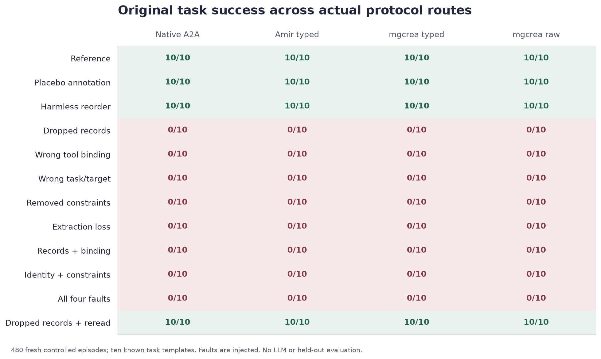
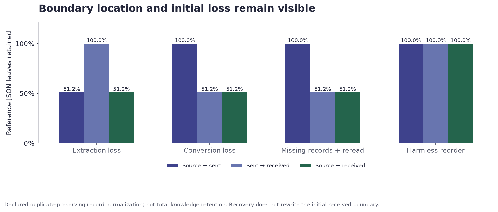
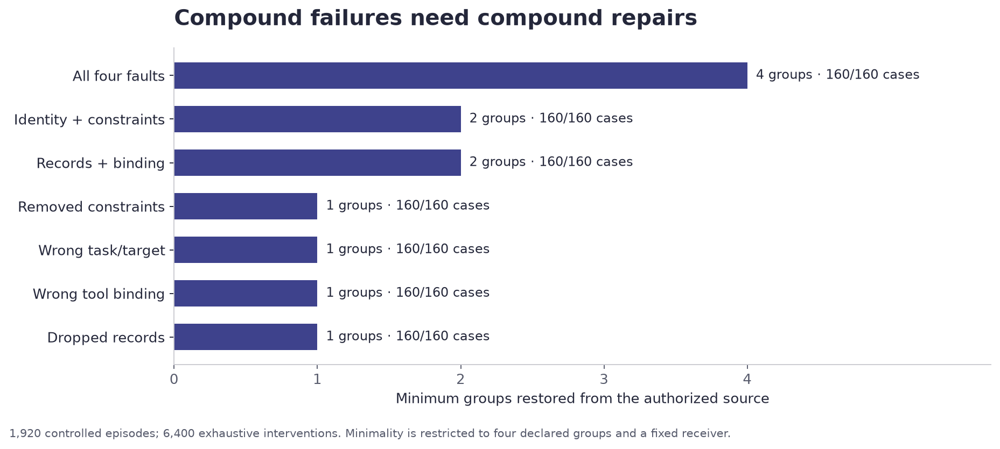

# Benchmark framework: supervisor handoff

**Review: 13 November 2026, 9:00 am IST.** Project: *Benchmarking Framework for LLM-Based Agent Interoperability: Measuring Interoperability Loss Across Heterogeneous Agent Boundaries*.

The framework now runs controlled tasks through genuine A2A/MCP routes, records what each boundary exposes, checks the original task outcome, diagnoses finite repair requirements, and regrades captured evidence offline. The current delivery contains working software and a reproducible development benchmark. Human-reviewed gold, an untouched evaluation set and live-model application evaluation remain for the final research handoff in two days.

## Read this first

The clearest result is a completed upstream task whose required artifact disappears in a typed bridge view. In five fresh tasks per artifact, mgcrea's typed tools retain text but omit the structured data payload, file URI and inline image bytes. A permitted raw `GetTask` read on the **same task and context** restores all required fields in **20/20** eligible recoveries. No replacement task, model call or upstream source modification produces that restoration.

Separately, the benchmark's own controlled task experiment executes **480 episodes over four actual protocol routes**, with **zero protocol execution errors**. References, harmless changes and authorized rereads pass; all intended damaging conditions fail the original task contract. An expanded local diagnostic bank supplies **1,920 episodes** and **6,400 executed repair interventions**, checked by a separate reconstruction program. **278 benchmark/core tests pass**, with one Windows symlink test skipped; five additional delivery I/O controls check byte equivalence and output preservation.

These numbers have different denominators. Generated diagnostic instances, protocol tasks, repeated artifact commands, software assertions and repair interventions are not interchangeable samples and are not pooled into one performance percentage.

| Evidence delivered | Quantity | What it establishes |
| --- | ---: | --- |
| Generated local diagnostic bank | 160 instances, 10 known families, 12 conditions; 1,920 episodes | Boundary measurement and repair behavior under declared finite rules |
| Real protocol task execution | 480 episodes; 4 routes; 960 separate read probes | Actual transport/SDK/bridge execution of our controlled task contract |
| Unchanged upstream artifact fixture | 80 fresh tasks; 4 commands; 5 repetitions; 4 routes | Survival of specifically required artifact fields |
| Same-task artifact recovery | 20 additional raw reads | Restoration using the original public task/context |
| Current software validation | 278 pass, 1 skip, 0 failures/errors | Metric, runner, verifier and finite admission controls |
| Delivery I/O controls | 5 pass | Streaming output matches frozen canonical JSON; overwrite/nonfinite rejection retained |
| Fresh admission demonstration | 8/8 commands; 11 finite cases; captured replay | Executable decision/certificate workflow and four-method comparison |
| Historical input replay | 13 retained observations, kept separate | Reanalysis of earlier captures; no fresh application qualification |

**Start the review:** open [the evidence explorer](demo/benchmark-v2/index.html), initially at **Structured data / mgcrea typed**, then compare the required source, typed observation and same-task raw recovery. The [run guide](benchmark/loss-v2/README.md) explains offline verification and fresh execution.

## What has been built

The cumulative implementation includes a strict episode schema, six measurement areas, a finite continuation-admission implementation, independent certificate checking, corrected direct comparators, source/capture manifests, historical-input replay and local supervisor tools. This handoff extends the earlier development-only loss benchmark into fresh protocol execution and artifact-level experiments.

| Component | Earlier development release | Current addition and verification |
| --- | --- | --- |
| Task bank | 10 authored task templates, 8 controlled conditions | 16 consistent transformations per family and 12 conditions; identifiers, dates/latencies and ordering change together |
| Boundary diagnostics | Recorded source/sent/received facts | Exact JSON leaf differences, duplicate-preserving record normalization, separate raw-order differences |
| Failure explanation | Individual injected faults | Single and compound faults; exhaustive subset repair certificates over four declared groups |
| Protocol runner | Retained historical captures | Native A2A HTTP, Amir MCP HTTP, mgcrea production MCP stdio CLI, typed and raw tools |
| Artifact experiment | No current four-part survival allocation | Unchanged upstream text/data/file/image fixture; authoritative reads and same-task raw recovery |
| Evidence verification | Byte hashes and finite replay | Reconstructed gold, receiver reexecution, wire/result matching, task/context binding, real probe association, costs and minimality |
| Review delivery | Earlier report/replay | This Markdown report, four data-derived figures, responsive evidence explorer and offline sharing package |

This is concrete framework engineering. The finite repair certificates and task-conditioned boundary diagnostics are implemented contribution candidates. Their novelty relative to research literature is **not yet established**. The upstream typed projection is documented behavior, not a claim of a new upstream bug.

## How the framework works



The receiver subprocess receives only the observed task input. It does not receive expected answers. The checker separately regenerates task gold, reruns the receiver and compares public responses with authoritative native artifacts. Discovery, requests, responses, task IDs and context IDs remain available in the evidence.

Every run uses an unused output directory. Manifests enumerate complete allocations and pin bytes and source hashes. Failed smoke attempts remain preserved; final results use named final allocations. Later recovery does not rewrite the initial boundary or convert an earlier loss into full retention.

### Six separate measurement areas

| Area | Implemented measurement | Interpretation |
| --- | --- | --- |
| Task completion | Confirmed original-task successes / all attempts, with failures and unknowns | A protocol acknowledgement or completed wrapper alone is insufficient |
| Context retention | Source → sent, sent → received, source → received; exact and declared normalized comparisons | Representation retention, not a universal percentage of knowledge |
| Required capability usability | Task-bound execution/read probes; advertised, required and reference-qualified behavior reported separately | Listing a tool does not prove its required operation works |
| Constraint/tool fidelity | Task identity, target, constraints, tool binding and observable required effects | Check-item denominators and observation coverage are explicit |
| Recovery | Eligible attempts, success, failure, unknown and N/A; original task retained | A new task is not accepted as recovery of the old one |
| Overhead | Wall time, messages, request/response bytes, tool calls and model tokens | Units remain separate; diagnostic probes and repair costs are separate |

Unknown values remain unknown. A missing capture differs from a captured omission. Exact JSON comparison preserves types and duplicate records; normalization only removes record ordering where declared by the task. The [full metric definitions](docs/research/loss-benchmark-metrics-v1.md) specify denominators and coverage.

## Result 1: required artifact loss and raw recovery

The artifact experiment uses the upstream Amir fixture without source changes. Our recorder forwards RPC request/response bytes unchanged; it rewrites discovery endpoint URLs to the loopback recorder. It does not fetch file URIs. Each route executes a fresh task, then retains its final public read and native association.

| Required payload | Native A2A | Amir typed | mgcrea typed | mgcrea raw |
| --- | ---: | ---: | ---: | ---: |
| Exact text | 5/5 | 5/5 | 5/5 | 5/5 |
| Structured data object | 5/5 | 5/5 | 0/5 | 5/5 |
| File URI | 5/5 | 5/5 | 0/5 | 5/5 |
| Inline PNG bytes | 5/5 | 5/5 | 0/5 | 5/5 |



**Text utility and full fidelity differ.** mgcrea typed preserves text utility in 5/5 text tasks, but omits media type. Across all 20 typed tasks, complete artifact fidelity is 0/20 and required-field retention is 5/50. Raw recovery succeeds in 20/20 eligible tasks and restores 50/50 fields, including text metadata.

For the structured-data example, the source includes `{"data":{"answer":42,"echo":"benchmark-survival"},"mediaType":"application/json"}`. The typed final artifact contains its ID, name and an empty text summary. The same-task raw final read contains the original structured data and media type. Inspect the [complete structured-data capture](runs/supervisor-handoff-20261113/parts-main-001/cells/data--r0--mgcrea_typed.json).

The source explanation is the upstream `summarizeWireArtifact` text-summary mapping in [shape.ts](external/mcp-a2a/src/client/shape.ts). An intentionally concise typed interface can violate a task's artifact requirement without being defective for its advertised purpose. The result supports requirement-aware route choice and raw recovery for this fixture; it does not establish failure prevalence across applications.

Recovery was selected adaptively after the earlier smoke experiment and fixed before the final allocation. These repetitions are development evidence, not an untouched test set.

**Evidence:** [allocation](runs/supervisor-handoff-20261113/parts-main-001/allocation.json), [results](runs/supervisor-handoff-20261113/parts-main-001/results.json), [separate verification](runs/supervisor-handoff-20261113/parts-verification-001/verification.json), [lifecycle record](runs/supervisor-handoff-20261113/parts-main-001/lifecycle.json).

## Result 2: actual protocol task execution

Ten known task templates are executed under twelve conditions through four actual routes. The service is our deterministic receiver hosted with the genuine installed A2A SDK; the bridge implementations are unchanged. mgcrea runs through its production stdio CLI, rather than an in-memory substitute.

| Condition | Each route's original-task passes / attempts |
| --- | ---: |
| Reference | 10/10 |
| Placebo annotation | 10/10 |
| Harmless record reorder | 10/10 |
| Dropped records | 0/10 |
| Wrong tool binding | 0/10 |
| Wrong task/target | 0/10 |
| Removed constraints | 0/10 |
| Source extraction loss | 0/10 |
| Records + tool binding | 0/10 |
| Task identity + constraints | 0/10 |
| All four faults | 0/10 |
| Dropped records + authorized reread | 10/10 |



All **480 allocated episodes** execute; there are **zero protocol execution errors**, no changed captured sources and the service closes. The 960 additional read probes are actual task-bound operations, verified against their native requests and final reads. They are excluded from episode overhead.

The intentionally injected faults establish that the scoring/diagnostic pipeline detects these losses and binds success to the original task. They do not show that each bridge naturally introduces each fault. The artifact experiment above supplies the separate observed upstream projection contrast.

**Evidence:** [allocation](runs/supervisor-handoff-20261113/protocol-main-001/allocation.json), [results](runs/supervisor-handoff-20261113/protocol-main-001/results.json), [verified normalized episodes](runs/supervisor-handoff-20261113/final-verification-001/protocol-episodes.json), [route metrics and cost vectors](runs/supervisor-handoff-20261113/final-verification-001/protocol-metrics-summary.json).

## Result 3: boundary localization and finite repair certificates

The local diagnostic suite expands the ten known families into 160 consistent generated instances. It includes filtered counts, joins, latency comparison, bounded dependency reachability, deployment selection, alert filtering, duration, threshold/headroom and snapshot checks. They are transformations of development families, not 160 independent problems.

Each instance runs all twelve conditions. Reference, placebo, harmless reorder and authorized recovery each pass **160/160**. Each of the eight damaging conditions passes **0/160**.



The diagnostic compares source/sent/received snapshots. Dropping records before sending produces extraction loss while conversion retains the sent representation. Dropping them at conversion leaves extraction intact. Reordering retains 100% under the declared duplicate-preserving record normalization, while raw ordering remains separately inspectable. An authorized later reread can restore task success while the initial conversion loss remains recorded. The 51.2% chart value is a leaf-weighted result for this bank, not a general information-loss percentage.

Repairs are explicit replacements from the authorized source in four groups: **records, task identity, constraints and tool binding**. Every subset of the changed groups is executed with the fixed receiver. The certificate retains all trials, successful subsets, inclusion-minimal sets and minimum cardinality.

| Fault | Minimum repair groups | Observed consistency |
| --- | ---: | ---: |
| Single record, identity, constraint or binding fault | 1 | 160/160 per condition |
| Records + binding | 2 | 160/160 |
| Identity + constraints | 2 | 160/160 |
| All four faults | 4 | 160/160 |



All **1,920 certificates** and **6,400 interventions** are reconstructed and reexecuted by the separate checker. This proves minimality inside the declared finite group universe and receiver policy. It does not prove globally cheapest natural-language repair, autonomous agent repair quality or minimum model tokens. Diagnostic intervention costs remain separate from task overhead.

Inspect [one all-four-fault certificate](runs/supervisor-handoff-20261113/diagnostics-final-001/cells/alerts-unsuppressed-count-v000-20261113--compound_all/diagnosis.json), [the bank](runs/supervisor-handoff-20261113/diagnostics-final-001/input-bank.json), [the final summary](runs/supervisor-handoff-20261113/diagnostics-final-001/results.json) and [verification](runs/supervisor-handoff-20261113/final-verification-001/verification.json).

## Verification and engineering confidence

| Check | Fresh result |
| --- | --- |
| Benchmark/metric/runner/verifier controls | 97 pass, 1 Windows symlink skip |
| Finite model/admission/comparator controls | 181 pass, 0 skips |
| Delivery output controls | 5 pass; Unicode, JSON types/duplicates, nested ordering, output preservation and nonfinite rejection |
| Diagnostic evidence reconstruction | 1,920 episodes; 6,400 repair interventions; 5,770 manifest files |
| Protocol evidence reconstruction | 480 episodes; 859 manifest files; 2,604 episode wire records; 4,800 probe wire records |
| Protocol association checks | 480 original task/context associations; 960 actual probes |
| Artifact evidence reconstruction | 80 tasks; 80 native associations; 20 same-task recoveries; 462 wire records; 121 manifest files |
| Admission command and captured replay | 8/8 commands; 44 algorithm and 11 reference results agree, excluding only elapsed time |
| Explorer browser checks | 16 artifact selections/raw links; 480 protocol selections; 120 repair selections; missing-data state; desktop and 390px mobile; [receipt](reports/supervisor-20261113/ui-validation/browser-check.json) |
| Portable release | See [delivery validation](reports/supervisor-20261113/delivery-validation.json) for clean-package execution and integrity verdict |

The verifier does more than compare a producer summary with itself: it reconstructs task gold and transformations, reruns receivers, checks every repair subset and minimality, matches public final results to captured wire and authoritative artifacts, links read probes to tasks, checks cost partitions and verifies complete manifests. Adversarial controls reject false success, forged probes, task/context substitutions, altered wire bytes, changed recovery tasks/artifacts and replaced gold.

The checker is a separate reconstruction program, with AI assistance. It shares the receiver and gold-computation functions with the runner, so its checks establish trace consistency, reconstruction and protocol associations; they do not independently validate the correctness of task semantics. It is not an independent human assessor. The software counts above are one current suite; earlier overlapping suite counts are not added. See [software receipt](runs/supervisor-handoff-20261113/software-validation-001/result.json) and [verifier controls](tests/test_loss_release_verifiers_v2.py).

The review surface has [desktop](reports/supervisor-20261113/images/explorer-desktop.png) and [mobile](reports/supervisor-20261113/images/explorer-mobile.png) captures with source-hash provenance. Its scoped review fixes were [checked separately](reports/supervisor-20261113/ui-validation/finish-verdict.md).

### Continuation-admission subsystem

The supplied finite-profile command returns `supported`, `unsupported` or `unknown`, retains witnesses/negative certificates and checks conclusive certificates independently. The fresh rehearsal runs a supported witness, an unsupported obstruction, an opaque unknown and a budget-exhausted unknown, followed by the original eleven-case four-method benchmark and captured replay.

Every method returns four supported, three unsupported and four unknown cases; all seven conclusive certificates per method are accepted. Shared lifting has no certified-case advantage in this suite. This preserves a working method implementation without manufacturing a superiority result. See [inspection](runs/supervisor-handoff-20261113/admission-demo-001/inspection.json), [replay comparison](runs/supervisor-handoff-20261113/admission-demo-001/replay-comparison.json) and [fresh run receipt](runs/supervisor-handoff-20261113/admission-demo-001/result.json).

### Cost boundaries

Protocol cost vectors retain episode wall time, messages, request/response bytes, tool calls and zero measured model tokens. Client and upstream layers are separately available; diagnostic read probes, setup and repair intervention costs are not pooled into episode costs. Loopback timing includes the owned receiver process and can include warm-up/scheduling effects. These fixed-order development timings do not establish production bridge speed rankings or remote network performance.

### Failures preserved and corrected

| Preserved attempt | Harness problem | Final disposition |
| --- | --- | --- |
| [native smoke 001](runs/supervisor-handoff-20261113/protocol-native-smoke-001/results.json) | Our SDK SendMessage envelope was unpacked incorrectly | Corrected and rerun in a new allocation; final protocol run passes |
| [bridge smoke 001](runs/supervisor-handoff-20261113/protocol-bridge-smoke-001/results.json) | Our artifact selector chose the first stale artifact after recovery | Corrected final-artifact selection; final protocol run passes |
| Initial explorer missing-data check | CSS grid overrode the HTML hidden state | Hidden state fixed; final browser check passes |
| [First packaging attempt](reports/supervisor-20261113/packaging-first-attempt.json) | Bulk file copy stalled on a 10 MB JSON with about 68 MB free host RAM | Partial package preserved; 64 KiB streaming copy completed the successor |
| [Second packaging attempt](reports/supervisor-20261113/packaging-second-attempt.json) | Summary export stalled after saved-task regrading | Partial validation preserved; a declared, byte-equivalent streaming output adapter is used in the final pipeline |
| [Third packaging attempt](reports/supervisor-20261113/packaging-third-attempt.json) | A test's scaling-generator helper was absent from the allowlist | Helper added; full software census is required in the final clean run |

These are framework development errors. They are not reported as upstream protocol failures. Earlier smoke and superseded diagnostic allocations remain in the workspace; the main tables use `diagnostics-final-001`, `protocol-main-001` and `parts-main-001` exclusively.

## Reproduce and inspect

Extract the sharing ZIP, keep its directory structure and start in the extracted root. **Python 3.12+** is required; **3.13.1** was tested. The default offline path uses the standard library, with no bridge installation or provider credentials. Use an unused output directory.

```powershell
python -B scripts/run_loss_handoff_v2.py --output runs/my-supervisor-check-001
```

This regrades saved diagnostic/protocol/artifact evidence and runs the software suites. It does **not** reexecute a live protocol service.

For large outputs the pipeline uses a delivery-only streaming adapter with the original canonical JSON settings. It changes the output writer at runtime; task, gold, receiver, conversion, scoring and checking functions remain fixed. Adapter source, tests and invocation are captured in the pipeline receipt. It is an I/O adaptation, not an experimental fault or semantic repair.

To additionally rerun local finite diagnostics and the admission/replay demonstration:

```powershell
python -B scripts/run_loss_handoff_v2.py --output runs/my-local-reproduction-001 --reproduce
```

For an inspection server, from the extracted/repository root:

```powershell
python -m http.server 8765 --bind 127.0.0.1
```

Open **http://127.0.0.1:8765/demo/benchmark-v2/**. The explorer also opens offline as `demo/benchmark-v2/index.html`. Its controls select saved evidence and do not start experiments.

Fresh protocol execution additionally requires the pinned full bridge installations, **Node 22.13.0**, Amir A2A SDK **1.1.0** and mgcrea A2A SDK **1.3.0**. The installed upstream checkouts were clean at commits:

- Amir: `58eff9da469bccdc432bf164662727947de646b4`
- mgcrea: `c4d9d3c57c1746abbf9f6aadd3a9912d464eb1f5`

The ZIP includes pinned captured source/build files and licenses for replay, not full Node dependency installations. The [run guide](benchmark/loss-v2/README.md) separates offline checks, full-checkout setup and `--live` execution. Plot regeneration uses optional matplotlib/Pillow; plots are already included as PNG and SVG with source-hash provenance. Browser test tooling is development-only.

## Eight-minute supervisor walkthrough

1. **First minute:** explain the task-relative question: did the receiver retain the information and operations required to finish the original task?
2. **Minutes 1–3:** open Structured data / mgcrea typed. Show the empty typed summary, native payload and same-task raw recovery. Switch to Text to explain utility versus metadata fidelity.
3. **Minutes 3–4:** open Protocol task outcomes. Explain genuine transports, unchanged bridges and the controlled fault design. Show a wrong-task condition so successful transport cannot masquerade as original-task completion.
4. **Minutes 4–6:** open Boundary and repair diagnostics, All four faults. Show sixteen retained subsets and why four groups are necessary. Explain the finite scope of this certificate.
5. **Minutes 6–7:** show the verification/software receipts and admission supported/unsupported/unknown examples. The unknown and preserved failure records demonstrate that the framework does not turn missing evidence into success.
6. **Final minute:** state the remaining scientific work and agree on the final evaluation scope below. Keep the report and ZIP for independent inspection.

## Final two-day handoff plan

| Priority | Work | Required completion evidence |
| --- | --- | --- |
| 1 | Supervisor/human review of task definitions, expected answers, artifact requirements and outcome predicates | Named review decisions and corrections; AI-generated gold alone is insufficient |
| 2 | Freeze new task cases and route requirements before execution | Untouched allocation/specification and hashes; current development cases remain development |
| 3 | Run approved original-application and available live-model routes with baseline feasibility checks | Actual task-bound traces, coverage, failures/unknowns, token/cost limits and clean shutdown |
| 4 | Compare the repair/diagnostic contribution with closest work and corrected simple baselines | A narrowly supported novelty claim, or an explicit engineering contribution if no novelty survives |
| 5 | Execute the frozen evaluation and final independent reproduction | New allocations, outcome/cost tables, complete verification and reproducible artifact |

The software framework is ready for inspection under its declared development scope. A full scientific benchmark of LLM-agent interoperability requires the remaining human-reviewed and qualified evaluation; this report does not award a completion percentage or claim publication readiness. Paper preparation is deferred for this handoff.
