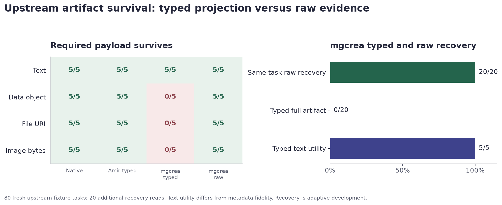

# BoundaryX progress update

Purpose: progress visibility. The supervisor is not a gold reviewer or evaluation approver.

BoundaryX is now a private modular research framework for measuring information, constraint, capability and artifact preservation across A2A and MCP. The original repository and useful older algorithm research remain preserved separately. [Repository](https://github.com/Eshiv-Pandey/BoundaryX) and [detailed report](FINAL_REPORT.md).

Completed development execution, with zero model calls:

- 1,920 diagnostic episodes and 6,400 finite repair interventions.
- 480 genuine protocol episodes, zero execution errors and 960 separate read probes. Damaging conditions were explicitly controlled fault injections.
- 80 artifact tasks. The typed bridge view retained 5/50 required fields; same-task raw recovery restored 50/50 fields in 20/20 eligible reads.
- Modular package, separate SQL/wire verifier, dependency-free clean-clone verification, regression controls and Linux CI. Windows upstream failures remain documented.

Next work: teammate review of 24 development examples, separate review of 20 frozen held-out proposals, qualification of new task execution, then untouched evaluation. All human judgments are blank today. Held-out gold, held-out performance, live LLM application evaluation and general scientific novelty are not established.

The separate verifier avoids the runner's critical scoring/gold functions but shares task definitions and captured observations. Passing checks supports reproducibility and contract consistency; human semantic review is still needed from the team. The supervisor receives updates on this work, with no approval gate.
